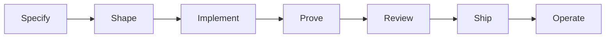

# ai-engineer

**Portable skills for the whole software job.**

Understand the repo. Specify the work. Change it. Prove it. Review it. Ship it. Run it.

Not tied to one coding agent, language, or role. Any agent that loads a `SKILL.md` folder can run this pack.

[Home](https://rajeshpraharaj.com/) · [MIT license](LICENSE) · 33 skills · contributions welcome

[](LICENSE)
[](#skills)
[](#why-this-exists)
[](#contribute)

---

## Why this exists

Coding agents are fast. Without a job, they guess the stack, skip the red loop, and call it done.

This pack is the job. Each skill is a short procedure with a **when**, a **do not**, and a **done** that requires evidence — command output, a written file, or a URL. Skills detect *this* repository. They do not invent `npm test`.

Use it if you:

- Work in more than one language or more than one agent
- Want the same quality bar on a greenfield folder and a ten-year monorepo
- Care more about a correct small change than a confident wrong one

Skip the ceremony when the ask is tiny. A one-line bug does not get a PRD.

## Quick start

```bash
git clone https://github.com/rpraharaj/ai-engineer.git
cd ai-engineer
./scripts/install.sh
python3 scripts/validate.py
```

That symlinks every skill into `~/.agents/skills/`. Agents that scan that directory pick them up in every project.

Then, in any product repo, ask in plain language:

> Map this repo before we change anything.

or invoke a skill by name — `/shape-work`, `$shape-work`, `@shape-work` — whatever your agent uses.

Copy [`templates/AGENTS.md`](templates/AGENTS.md) to the product repo root (or run `explore-codebase`) so the agent stops inventing commands.

## How a skill works

A skill is a folder with a `SKILL.md`. Compatible agents load `name` + `description` up front and the body only when the task matches.

```
skills/debug/SKILL.md          ← procedure (always)
skills/write-prd/references/   ← copy-templates, only when the doc is the job
```

Rules that apply in every product repo live in [`templates/AGENTS.md`](templates/AGENTS.md). The shared quality bar lives in `engineering-bar`. Other skills point at those by name. One home per fact.

## The loop



| When | Path |
| --- | --- |
| Existing repo | `explore-codebase` → `shape-work` → `implement-change` → `write-tests` → [`verify-ui` if UI] → `ready-to-merge` → `commit` → `open-pr` → `ship-notes` → [`cut-release` if they asked to publish] |
| Large / unclear product | `write-prd` → [`write-architecture` if new boundaries] → `write-design` → `write-dev-tasks` → `shape-work` (Task 1) → `implement-change` |
| Empty folder | `start-project` → `write-prd` → … |
| Vague ask | `shape-work` first, then implement |
| Clear small ask | `implement-change` directly |
| Bug / red CI / outage | `debug` / `fix-ci` / `incident-triage` — then `revert-change` if you are rolling back |

`shape-work` is still the contract for **one** implementable slice. `review-change` and `implement-change` are named so they do not replace a host's own review or implement commands.

## Skills

### Specify

Skip these when the ask is already a small, obvious change.

| Skill | Job |
| --- | --- |
| `write-prd` | Product requirements: problem, goals, success. |
| `write-architecture` | Durable system shape: boundaries, data, quality attributes. |
| `write-design` | How this initiative will be built in this repo. |
| `write-dev-tasks` | Ordered implementable tasks from a PRD or design. |
| `record-decision` | One-page ADR (context, options, choice, consequences). |

### Daily loop

| Skill | Job |
| --- | --- |
| `engineering-bar` | Shared quality bar. Other skills apply this; do not restate it. |
| `explore-codebase` | Map a repo, run it, write commands and a glossary into `AGENTS.md`. |
| `start-project` | Empty directory → smallest runnable project on the stack they named. |
| `shape-work` | Vague ask → scoped task; decision pass when the change is large. |
| `implement-change` | Smallest change that matches this repo. Shaped work or a clear small ask. |
| `explain-code` | Teach one feature or path from the code that exists. |
| `debug` | Tight red loop first, then minimise, hypothesise, fix, prove. |
| `write-tests` | Tests at public seams, this repo's runner and style. |
| `verify-ui` | Click through a UI change; not a screenshot. |
| `write-docs` | README, API docs, or runbook from the code. |
| `commit` | Honest commit from the real diff. |
| `open-pr` | PR/MR body + test plan; host CLI if available. |

### Quality and shipping

| Skill | Job |
| --- | --- |
| `ready-to-merge` | Definition of done: mechanical checks, bar, dispatch passes. |
| `review-change` | Structured review of a local or branch diff (read-only). |
| `lean-review` | Over-engineering review: delete-list for a diff or the whole repo. |
| `performance` | Investigate slowness, or guard a diff for regressions. |
| `security-pass` | Threat-model this delta. |
| `production-pass` | Timeouts, retries, visibility, rollback, compatibility. |
| `data-change` | Expand-then-contract schema/API/data migrations. |
| `refactor-safely` | Behavior-preserving cleanup with tests first. |
| `fix-ci` | Reproduce the failing check; fix the cause. |
| `resolve-conflicts` | Finish an in-progress merge or rebase by intent. |

### Operate and continue

| Skill | Job |
| --- | --- |
| `incident-triage` | Blast radius, stabilize vs fix, evidence. |
| `revert-change` | Undo a commit, merge, or deploy without rewriting shared history. |
| `ship-notes` | Changelog / release notes from the commit range. |
| `cut-release` | Tag, publish, or deploy using this repo's existing path. |
| `handoff` | Continuation brief for the next person or session. |
| `upgrade-deps` | Update deps, run the suite, do not hide breakages. |

## Pick a skill

This table is the router. There is no extra router skill.

| You want to… | Skill |
| --- | --- |
| Map an unfamiliar repo | `explore-codebase` |
| Start from an empty folder | `start-project` |
| Write a PRD / product spec | `write-prd` |
| Write system architecture | `write-architecture` |
| Write a technical design | `write-design` |
| Break work into tickets | `write-dev-tasks` |
| Scope a vague ask / first slice | `shape-work` |
| Add or change behavior (shaped or a clear small ask) | `implement-change` |
| Understand how a feature works | `explain-code` |
| Fix a bug / failing test | `debug` |
| Add tests | `write-tests` |
| Prove a UI change | `verify-ui` |
| Write README / API docs / a runbook | `write-docs` |
| Record why we picked X | `record-decision` |
| Commit | `commit` |
| Open a PR | `open-pr` |
| Are we ready to merge? | `ready-to-merge` |
| Review the diff | `review-change` |
| What can we delete? | `lean-review` |
| Something is slow | `performance` |
| Threat-model this change | `security-pass` |
| Is this production-safe? | `production-pass` |
| Change a schema or contract | `data-change` |
| Refactor without changing behavior | `refactor-safely` |
| CI is red | `fix-ci` |
| Mid-rebase / fix the conflicts | `resolve-conflicts` |
| Prod is down | `incident-triage` |
| Undo a commit or deploy | `revert-change` |
| What shipped? | `ship-notes` |
| Tag, publish, or deploy | `cut-release` |
| Hand this off | `handoff` |
| Upgrade deps | `upgrade-deps` |

## Install

### This machine (all your projects)

```bash
./scripts/install.sh
```

Symlinks each skill into `~/.agents/skills/`. If an agent only scans its own skills directory, symlink from `~/.agents/skills/<name>` into that directory. Do not maintain a second edited copy.

### One product repo (share with a team)

```bash
mkdir -p .agents/skills
cp -R /path/to/ai-engineer/skills/* .agents/skills/
cp /path/to/ai-engineer/templates/AGENTS.md ./AGENTS.md
```

A git submodule works the same way. Then fill **This repo** in `AGENTS.md`, or run `explore-codebase`.

`.agents/skills/<name>/SKILL.md` is the portable location. Other vendor skill folders are optional mirrors, not the source.

## Contribute

This pack is open source on purpose. It gets better when people who do different jobs send back the jobs they actually run.

You do **not** need to be a “skills expert.” A clear procedure you wish an agent would follow is enough.

### Good first contributions

- A missing **job** people already ask for (not a framework tutorial)
- Another row in `explore-codebase` or `upgrade-deps` for a stack you actually use
- A hole in a copy-template (keep the heading, write `n/a` — do not invent metrics)
- A routing bug (“this ask hit the wrong skill”)
- Shorter prose that does not drop a step
- Fixes to `scripts/validate.py` or `scripts/install.sh`

### Please don’t

- Name a host product, host tool, or host slash command in a skill body
- Add host-only frontmatter (`when-to-use`, `model`, `allowed-tools`, …)
- Paste `engineering-bar` or `AGENTS.md` defaults into another skill
- Add a per-framework skill (`react`, `django`, `kubernetes`)
- Add an empty `references/` folder “for later”
- Delete or skip a failing check to make `validate.py` green

### How to send a change

1. Read [`AGENTS.md`](AGENTS.md). That is the authoring contract.
2. Copy the shape of a sibling skill. Look at `handoff` or `verify-ui` for a small procedure; `write-prd` for a skill that ships a template.
3. Put copy-templates under `skills/<name>/references/`. Keep `SKILL.md` under 500 lines.
4. `description` must say **what** the skill does and **when** to use it.
5. Mention the new skill as `` `name` `` in this README (the validator checks).
6. Run:

```bash
python3 scripts/validate.py
```

7. Open a pull request that states the **job**, **when to use it**, and **what you did not add**.

If you are unsure whether something belongs, open an issue first. “Should this be a skill or a section of `engineering-bar`?” is a good issue.

Questions about the pack itself: [rajeshpraharaj.com](https://rajeshpraharaj.com/).

## License

[MIT](LICENSE). Use it, fork it, ship it with your team. If you improve a skill, send it back so the next person does not have to guess.
